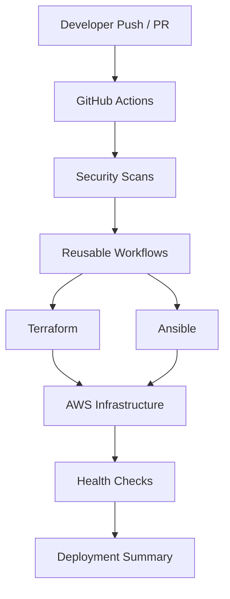

# Terraform + Ansible Enterprise IaC Platform

[](https://www.terraform.io/)
[](https://www.ansible.com/)
[](https://aws.amazon.com/)
[](https://github.com/features/actions)

Enterprise-grade Infrastructure as Code platform using Terraform, Ansible, AWS, and GitHub Actions with full DevSecOps integration.

---

## Project Overview

This repository provides a production-ready, secure, and maintainable platform for provisioning and configuring AWS infrastructure using Terraform and Ansible, orchestrated through GitHub Actions with comprehensive security, cost governance, and multi-environment support.

## Architecture Overview



## Technology Stack

| Layer | Technology |
|-------|------------|
| Infrastructure Provisioning | Terraform |
| Configuration Management | Ansible |
| Cloud Provider | AWS (EC2) |
| CI/CD | GitHub Actions |
| Security | TruffleHog, Checkov, TFLint, Trivy, OPA |
| Cost Governance | Infracost |
| State Management | AWS S3 + DynamoDB |

## Enterprise Features

- **Reusable Workflows** — DRY CI/CD with `workflow_call`
- **Multi-Environment** — Isolated dev / staging / prod
- **DevSecOps** — Full security scanning pipeline
- **Cost Control** — Infracost on every PR
- **OIDC Authentication** — No long-lived AWS credentials
- **Professional Documentation** — Enterprise-grade README

## Repository Structure

```
terraform-ansible-project/
├── .github/
│   ├── workflows/
│   │   ├── deploy.yaml
│   │   ├── reusable-terraform.yaml
│   │   ├── reusable-ansible.yaml
│   │   └── reusable-security-scan.yaml
│   ├── CODEOWNERS
│   ├── PULL_REQUEST_TEMPLATE.md
│   └── dependabot.yml
├── environments/
│   ├── dev/
│   ├── staging/
│   └── prod/
├── terraform/
│   ├── modules/
│   └── shared/
├── ansible/
│   ├── inventories/
│   ├── playbooks/
│   ├── roles/
│   └── molecule/
├── policies/
│   └── opa/
├── scripts/
├── docs/
├── README.md
├── .gitignore
├── .trivyignore
├── .tflint.hcl
├── .checkov.yaml
├── .ansible-lint
└── infracost.yml
```

## Multi-Environment Strategy

| Environment | Deployment Trigger | Approval Required |
|-------------|--------------------|-------------------|
| `dev` | Automatic on merge to main | No |
| `staging` | After successful dev deployment | No |
| `prod` | Manual approval + reviewed plan | Yes |

## Prerequisites

- AWS Account with appropriate IAM permissions
- GitHub repository with Actions enabled
- Terraform ≥ 1.9
- Ansible ≥ 2.15

## GitHub Secrets Required

| Secret | Description |
|--------|-------------|
| `AWS_ROLE_ARN_DEV` | OIDC role ARN for dev |
| `AWS_ROLE_ARN_STAGING` | OIDC role ARN for staging |
| `AWS_ROLE_ARN_PROD` | OIDC role ARN for prod |
| `SSH_PRIVATE_KEY` | EC2 SSH private key |

## Quick Start

```bash
git clone https://github.com/grlokesh96/terraform-ansible-project.git
cd terraform-ansible-project

# Review and apply Terraform
cd environments/dev
terraform init
terraform plan
terraform apply

# Run Ansible
cd ../../../ansible
ansible-playbook -i inventories/dev playbook.yml
```

## License

This project is licensed under the MIT License.

---

*Enterprise-grade Infrastructure as Code platform — Secure • Scalable • Maintainable*
